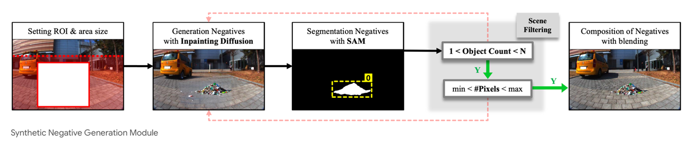
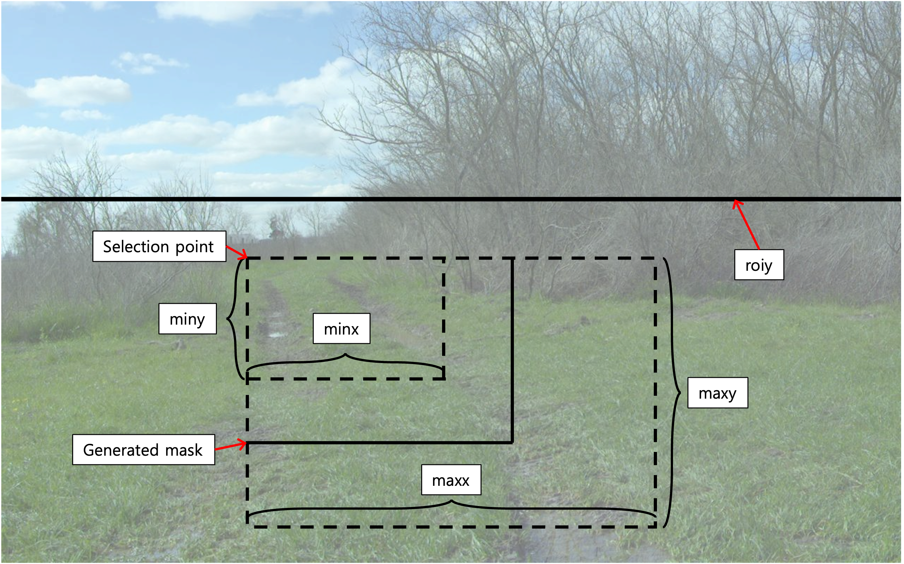

# Diffusion Generation Pipeline for SyNeT

---


This repository is for the inpainting pipeline used in our SyNeT pipeline:
https://anonymous.4open.science/r/SyNet-8B8D/README.md

available inpainting pipeline
- stabilityai/stable-diffusion-3.5-large
- black-forest-labs/FLUX.1-Fill-dev

## How to Run

### 0. requirement

- A high-end GPU that meets or exceeds the recommended specifications for each diffusion model is required (e.g. A6000, RTX 5090, A100, ...)
```text
torch >= 2.6.0
numpy >= 2.2.6
diffusers >= 0.32.2
pillow >= 11.0.0
scipy >= 1.16.0
tqdm >= 4.67.1
sentencepiece>=0.2.1
```

``` bash
pip install -r requirements.txt
```

You also need to download LangSAM from the following URL:
https://github.com/luca-medeiros/lang-segment-anything  

### 1. write prompt and geometrical constrain in ./prompt directory



- example

```json
{
    "mask": {
        "roiy": 300,
        "minx": 300,
        "maxx": 500,
        "miny": 200,
        "maxy": 400
    },
    "prompt" : "a realistic bicycle lying on the ground",
    "negative": ""
}
```
- roiy : Restricts the y-region where the mask can be generated
- minx : Minimum x-size of the mask
- maxx : Maximum x-size of the mask
- miny : Minimum y-size of the mask
- maxy : Maximum y-size of the mask

#### prompt Guide:
To generate as diverse a set of objects as possible, we specify only the object category and leave the rest to the diffusion model.

The prompt format we propose is as follows:
- For objects placed on the ground
```text
a realistic <target object> lying on the ground
```
- For all other cases
```text
add a realistic <target object>
```

Additionally, for objects with basic anatomical features such as a person or a dog, we found that explicitly specifying body parts such as `2 ears`, `2 eyes`, and `2 legs` improves the generation results. 

In particular, it is recommended to explicitly include `full body` in the prompt.

### 2. change configuration in ./config/config.json

```json
{
    "gen_info": {
        "max_obj": 5,
        "max_try": 5,
        "blur_radius": 5,
        "min_ratio": 0.05,
        "max_ratio": 0.95
    },

    "SEED": 1234,
    "REF_SIZE": [1280, 800],
    "DEVICE": "cuda:0",
    "MODEL_ID": "black-forest-labs/FLUX.1-Fill-dev",
    "continued": false,
    "tgt_obj": "bicycle",
    
    "img_pth": "",
    "save_pth": "",
    "mask_pth": "",
    "sam_mask_pth": "",
    "log_dir": "./logs"
}
```
- max_obj : Maximum number of objects per one step
- max_try : Maximum number of generation attempts for the same mask. If generation fails repeatedly up to this limit, a new mask is generated.
- blur_radius : Radius used to blur the mask boundary before diffusion. This helps produce more natural result, although the generated object may slightly exceed the predefined size constraints
- min_ratio : Minimum area ratio that the generated object should occupy within the mask
- max_ratio : Maximum area ratio that the generated object can occupy within the mask
- SEED : Random seed used for generation
- REF_SIZE : Reference output resolution for generation. Since diffusion models require dimensions divisible by 16, the resolution is adjusted to the nearest multiple of 16 if necessary. If the aspect ratio of the input image differs from REF_SIZE, resizing is performed based on the larger downsampling ratio.
- DEVICE : GPU device index used for generation
- MODEL_ID : ID of the diffusion model used for generation (support : stabilityai/stable-diffusion-3.5-large, black-forest-labs/FLUX.1-Fill-dev)
- continued : If true, the pipeline skips images that have already been processed in the target directory and continues from the remaining ones. If false, generation starts from the beginning. (Existing files are not explicitly removed, but files with the same name will be overwritten.) 
- tgt_obj : Name of the prompt file to use. (if tgt_obj is bicycle, the pipeline uses bicycle.json.)
- img_pth : Path to the directory containing input images
- save_pth : Path to the directory where generated images are saved
- mask_pth : Path to the directory where generated masks are saved
- sam_mask_pth : Path to the directory where LangSAM masks for generated images are saved
- log_dir : Path to the directory where generation logs are saved


### 3. Run main.py 
```bash
python3 main.py
```

---

# Generation result under our Setting
### Generation Details

- Model ID : Stable Diffusion 3.5 Large

- GPU : NVIDIA A6000

- Image size : 1040 $\times$ 768

- Generation time : 20-21 seconds per generation attempt

### Regeneration rate per prompt (In RUOS)

Regeneration is performed when LangSAM fails to detect the object, or the generated object is either too small or too large.
- dog : 1.07\%, - box : 0.77\%, - people : 1.6\%
